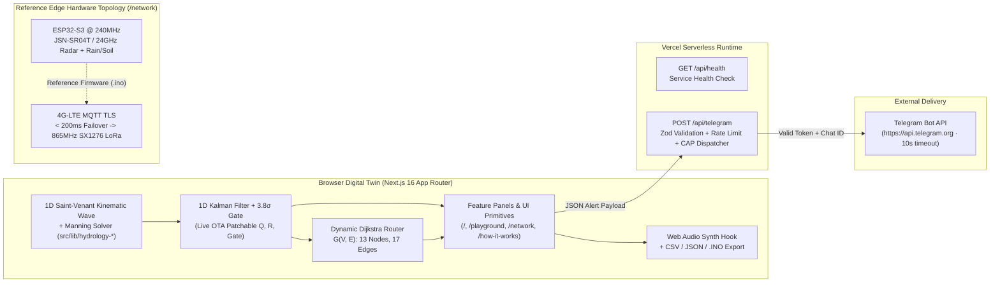
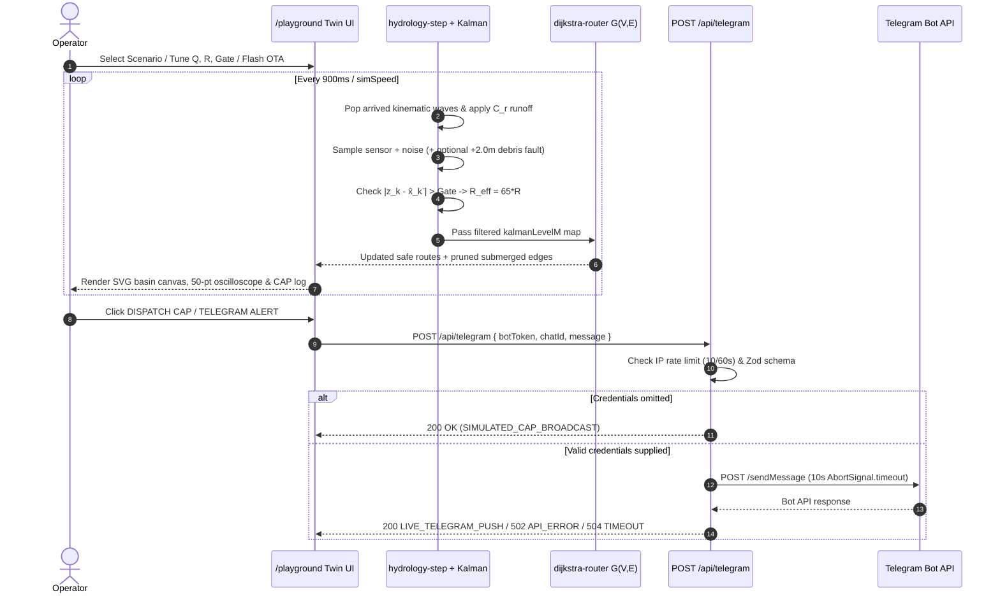
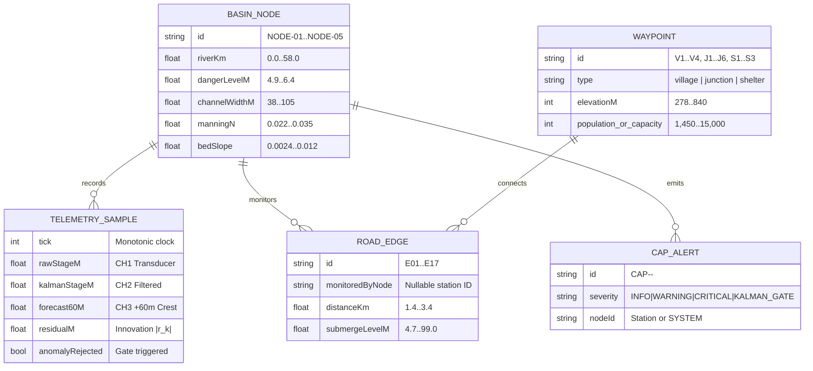

# AegisFlood — Architecture

---

## 1. Stack & Runtime Versions

| Layer | Technology & Exact Version | Runtime / Region / Notes |
|---|---|---|
| Framework | Next.js `16.4.5` (App Router, Turbopack) · TypeScript `7.0.2` | Node `22.x` · Vercel `bom1` (`aegisflood.tanisheesh.in`) |
| UI & Styling | React `19.3.1` · Tailwind CSS `4.3.3` · `lucide-react 1.69.0` | CSS custom properties (`globals.css`, `#FF4D00` signal, WCAG 2.1 AA) |
| Simulation & Graph Engine | Pure TypeScript (`src/lib/hydrology-*.ts`, `src/lib/dijkstra-router.ts`) | Client-side deterministic loop (`1x` / `2x` / `4x`), zero DB |
| Alert & Health API | Next.js Route Handlers (`POST /api/telegram`, `GET /api/health`) · Zod `4.6.7` | Sliding-window IP rate limit (`10/60s`) · `10s` `AbortSignal.timeout` |
| Edge Reference Firmware | C/C++ (`WiFi.h`, `PubSubClient.h`, `SPI.h`, `LoRa.h`) | ESP32-S3 (`240 MHz`) + SX1276 `865 MHz` LoRa + JSN-SR04T |
| Audio Synthesis | Browser Web Audio API (`src/hooks/use-tactical-audio.ts`) | User-gated `SYNTH ON` sawtooth alert tone with safe fallback banner |
| Testing & Security | Biome `2.6.8` · Vitest `5.1.1` · Playwright `1.65.1` · `@axe-core/playwright 4.14.0` · CodeQL · Gitleaks | Enforced on every PR via `.github/workflows/` + `vercel.json` headers |

---

## 2. System Topology & Components



```text
src/
  app/
    page.tsx                 [01] Specification landing page (Server Component)
    playground/page.tsx      [02] Thin Digital Twin workbench composition
    network/page.tsx         [03] ESP32-S3 Node Topology, Fault Simulator & .ino export
    how-it-works/page.tsx    [04] 5 governing hydrological/Kalman/Dijkstra laws & v2 roadmap
    api/
      health/route.ts        GET /api/health stateless liveness check
      telegram/route.ts      POST /api/telegram Zod-validated, rate-limited CAP/Telegram API
    layout.tsx               Root metadata (site-config.ts), JSON-LD schema & viewport
    globals.css              NDRF Tactical Blaze (#FF4D00) tokens, :focus-visible & brutal-btn
    opengraph-image.tsx      Dynamic 1200x630 PNG OpenGraph generator (re-exported by twitter-image.tsx)
    apple-icon.tsx           Dynamic 180x180 PNG Apple touch icon
    icon.svg                 Square tactical brand SVG icon with accessible <title>
    manifest.ts / robots.ts / sitemap.ts
  components/
    navbar.tsx / footer.tsx  Sticky navigation + responsive 4-tab mobile bar + footer
    ui/
      aegis-logo.tsx         Shared brand SVG mark (zero duplication across nav/footer)
      status-banner.tsx      Reusable success / warning / error / info banner with retry action
    features/
      scenario-bar.tsx       Scenario presets, sim clock (1x/2x/4x), audio & overlay toggles
      basin-canvas.tsx       Interactive 5-node SVG river canvas
      basin-graph-overlay.tsx Road graph G(V,E) edges & waypoint layers
      station-selector-bar.tsx 5-station quick-select telemetry bar
      kalman-oscilloscope.tsx Dual-trace SVG strip chart, forecast strip & CSV/JSON export
      workbench-controls.tsx 3-tab controller (Forcing/Faults, C++ OTA Patcher, CAP Dispatch)
      telegram-dispatch-tab.tsx Accessible Telegram credential form & status/retry banner
      evacuation-panel.tsx   Dynamic Dijkstra routing table & rolling CAP v1.2 event log
      node-schematic.tsx     Interactive ESP32-S3 + LoRa + MPPT hardware schematic
      quickstart-panel.tsx   Interactive firmware / pinout / pnpm CLI quickstart tabs
  hooks/
    use-basin-simulation.ts  Simulation loop, scenario transitions & rolling telemetry state
    use-tactical-audio.ts    User-gated Web Audio sawtooth synth with explicit error reporting
  lib/
    basin-types.ts           Domain TypeScript interfaces
    basin-config.ts          5 river gauge station configs & Kalman constants
    road-graph-config.ts     13 waypoints (V1–V4, J1–J6, S1–S3) & 17 road edges (E01–E17)
    dijkstra-router.ts       Pure computeDijkstraEvacuation solver with isolated-zone handling
    hydrology-engine.ts      Pure 1D Kalman filter, Manning solver, runoff & multi-horizon forecast
    hydrology-step.ts        Pure single-tick kinematic wave + Kalman advancement engine
    scenario-presets.ts      6 deterministic flood/fault scenario transitions
    firmware-spec.ts / esp32-sketch.ts / landing-spec.ts
    telegram-schema.ts       Zod dispatch schema + sliding-window IP rate limiter
    file-export.ts           Shared CSV formatter & Blob download helper
    site-config.ts           NEXT_PUBLIC_SITE_URL origin resolver
    aegisflood-data.ts       Barrel re-export for domain modules
tests/
  unit/                      Vitest unit suites (dijkstra, hydrology/Kalman, telegram schema)
  integration/               Vitest API route integration tests (/api/health, /api/telegram)
  e2e/smoke.spec.ts          Playwright desktop (1280px) + mobile (375px) + axe-core WCAG AA
```

### Hydrological Kinematic Wave & Manning Solver (`src/lib/hydrology-engine.ts`, `src/lib/hydrology-step.ts`)

Advances the 5-node river cascade on a deterministic interval (`Math.round(900 / simSpeed)` ms across `1x`, `2x`, `4x`). Converts headwater rainfall intensity (`0–180 mm/hr`) and dam spillway discharge (`0–2,500 m³/s`) via `forcingSurge = rainMmHr / 48.0 + damReleaseM3s / 680.0` into wave packets with arrival delay `idx * 3` ticks and downstream attenuation `0.91^idx`. Updates soil moisture (`36.0%–98.5%`), computes runoff coefficient $C_r \in [1.0, 1.6]$, evaluates Manning open-channel velocity and volumetric discharge $Q$, and projects `+15m`, `+30m`, `+60m`, and `+120m` stage forecasts plus `ETA-to-Danger`.

### Edge 1D Kalman Filter & Innovation Gate (`stepEdgeKalman`)

Maintains per-node state $(\hat{x}_k, P_k, K_k)$. Before updating posterior stage, compares raw sensor reading $z_k$ against prior estimate $\hat{x}_k^-$ (`residualM = |rawStageM - state.x|`). Whenever `residualM > innovationGateM` (`0.45 m` default), `effectiveR` inflates `65×` (`kalmanR * 65.0`), driving Kalman gain $K_k$ near zero and flagging `isAnomalyRejected = true` (`KF GATE`) without triggering false `CRITICAL` sirens.

### Dynamic Dijkstra Evacuation Graph Solver (`src/lib/dijkstra-router.ts`)

Evaluates undirected road graph $G(V, E)$ (`13` vertices, `17` edges). Edges monitored by a river node (`NODE-01` to `NODE-04`) whose filtered stage satisfies `level >= submergeLevelM` are pruned ($w(e) = \infty$); edges within `0.65 m` of submergence receive a `3.2×` proximity penalty. Runs Dijkstra from each settlement to find the minimum-cost reachable shelter and explicitly flags `ISOLATED // AIRLIFT REQUIRED` when all connected edges are submerged.

### Hardened Alert & Health Endpoints (`src/app/api/`)

- `GET /api/health` returns stateless service health (`200 { ok, service, version, timestamp }`).
- `POST /api/telegram` enforces a per-IP sliding-window rate limit (`10 requests / 60s` → `429`), parses JSON safely (`400 INVALID_JSON`), validates payload with Zod (`400 VALIDATION_ERROR`, `4,096`-char max message, BotFather token & chat ID regex), returns `200 SIMULATED_CAP_BROADCAST` when credentials are omitted, or posts Markdown text strictly to `https://api.telegram.org/bot<token>/sendMessage` with a `10s` `AbortSignal.timeout` (`200`, `502`, or `504`).

---

## 3. End-to-End Request & Simulation Flow



1. **Forcing & Fault Injection:** Operator selects one of `6` scenario presets or adjusts rainfall (`0–180 mm/hr`), spillway (`0–2,500 m³/s`), `+2.0 m` debris glitch, or `4G` blackout toggles.
2. **Wave Propagation:** Headwater forcing schedules downstream wave packets across `NODE-01` (`KM 0.0`) → `NODE-05` (`KM 58.0`), scaled by catchment soil runoff coefficient $C_r$.
3. **Edge Kalman Estimation:** Sensor noise (`±0.035 m` uniform jitter) and optional `+1.85 m to +2.30 m` timber spikes pass through `stepEdgeKalman`; `residualM > innovationGateM` triggers `65×` variance inflation and logs `KALMAN_GATE`.
4. **Dynamic Evacuation Rerouting:** `computeDijkstraEvacuation` updates all `17` edges against current Kalman stages, marking flooded bridges `X SUBMERGED` and switching affected settlements to elevated bypasses (`J2`, `J4`, `J6`).
5. **Alert Dispatch & Export:** Operators export `50`-sample `.CSV`/`.JSON` logs locally or send a validated CAP v1.2 Markdown bulletin through `POST /api/telegram`.

---

## 4. In-Memory Domain Model & Basin Topology

AegisFlood is stateless with zero external database tables; its domain entities reside in typed TypeScript structures (`src/lib/basin-types.ts`, `src/lib/basin-config.ts`, `src/lib/road-graph-config.ts`):



### River Basin Stations (`BASIN_NODES`)

| Node | Sector | River KM | Elevation | Base / Warn / Danger / Critical (m) | Width / Manning $n$ / Slope $S_0$ | Reference MCU & Radio |
|---|---|---|---|---|---|---|
| `NODE-01` (`N01`) | Devprayag Confluence | `0.0` | `830 m` | `3.40 / 5.40 / 6.40 / 7.50` | `38 m` / `0.035` / `0.0120` | `ESP32-S3 @ 240MHz` · `SX1276 865MHz SF9` |
| `NODE-02` (`N02`) | Tapovan Spillway Barrage | `14.5` | `490 m` | `3.10 / 5.00 / 6.00 / 7.00` | `46 m` / `0.032` / `0.0085` | `ESP32-S3 @ 240MHz` · `SX1276 865MHz SF9` |
| `NODE-03` (`N03`) | Rishikesh Triveni Basin | `28.0` | `340 m` | `2.90 / 4.70 / 5.60 / 6.60` | `62 m` / `0.028` / `0.0055` | `STM32WL55 Dual-Core` · `Sub-GHz LoRa + 4G LTE` |
| `NODE-04` (`N04`) | Haridwar Bhimgoda Gate | `42.0` | `295 m` | `2.75 / 4.40 / 5.20 / 6.20` | `84 m` / `0.025` / `0.0038` | `STM32WL55 Dual-Core` · `Sub-GHz LoRa + 4G LTE` |
| `NODE-05` (`N05`) | Roorkee Solani Delta | `58.0` | `268 m` | `2.50 / 4.10 / 4.90 / 5.80` | `105 m` / `0.022` / `0.0024` | `ESP32-S3 + SIM7600` · `LTE Cat-4 + LoRa Gateway` |

### Floodplain Settlements & Shelters (`WAYPOINTS`)

- **Settlements (`18,850` total residents):** `V1` Sangam Ghat Cluster (`1,450`, `485 m`), `V2` Tapovan Lowland Market (`3,200`, `360 m`), `V3` Triveni Floodplain Ward (`5,800`, `312 m`), `V4` Kankhal Embankment Colony (`8,400`, `278 m`).
- **Shelters (`32,000` combined capacity):** `S1` NDRF Base Camp Tehri Ridge (`5,000`, `840 m`), `S2` AIIMS Highland Helipad Shelter (`12,000`, `560 m`), `S3` IIT Elevated Stadium Complex (`15,000`, `430 m`).

---

## 5. State, Ring Buffers & Concurrency Control

- **Simulation state & buffers:** Mutable loop refs (`tickRef`, `waveQueueRef`, `kalmanInternalRef`) in `useBasinSimulation` avoid stale React closures inside `setInterval`, while `computeDijkstraEvacuation` is memoized via `useMemo`.
- **Bounded memory windows:** Per-node telemetry history (`historyByNode`) initializes with `30` pre-warmed sinusoidal baseline points and caps at `50` rolling samples per station (`250` points total); rolling CAP bus log caps at `25` entries (`[newAlert, ...prev.slice(0, 24)]`); server rate-limit bucket map prunes expired keys above `1,000` distinct IPs.
- **No server DB locking:** Each browser tab runs an isolated twin instance; `TelegramDispatchTab` uses `isDispatching` submit lock while awaiting `POST /api/telegram`.

---

## 6b. Hydrological, Edge-AI & Hardware Pipeline

- **Models & Equations (Pure Deterministic TypeScript + C++):**
  - **1D Edge Kalman Filter:** Defaults `KALMAN_Q = 0.008 m²`, `KALMAN_R = 0.080 m²`, `INNOVATION_GATE_M = 0.450 m` ($3.8\sigma$ threshold). Prior variance $P_k^- = P_{k-1} + Q$; residual $r_k = |z_k - \hat{x}_k^-|$; anomaly scaling $R_{\text{eff}} = 65 \cdot R$ when $r_k > \text{gate}$; posterior $\hat{x}_k = \hat{x}_k^- + K_k(z_k - \hat{x}_k^-)$.
  - **Manning Discharge & Runoff:** $C_r(\theta_v) = 1.0 + 0.6 \cdot \max(0, (\theta_v - 50)/50) \in [1.0, 1.6]$; $v = n^{-1} R_h^{2/3} S_0^{1/2} \cdot 0.38 + Q_{\text{dam}}/1900$; $Q = A(h) \cdot v$.
  - **Dynamic Dijkstra:** $O(|V|^2)$ min-selection across `13` vertices (`169` vertex scans per call), `3.2×` proximity multiplier at `h >= submergeLevelM - 0.65`, `Infinity` weight when `h >= submergeLevelM`.
- **Datasets & Provenance:** Synthesized Himalayan-foothill river cascade geometry (`Devprayag` → `Roorkee`, `58.0 km`) and illustrative road graph `E01–E17` defined directly in `src/lib/` (no external dataset fetches).
- **Hardware & Telemetry Spec (`HARDWARE_MODULES` & `FULL_ESP32_SKETCH`):**

| Module | Component | Pinout / Bus | Key Operating Parameters |
|---|---|---|---|
| `MOD_01` | ESP32-S3 Dual-Core MCU | `GPIO4/5/10/14/2/19/21/34` | Xtensa LX7 @ `240 MHz`, `512 KB` SRAM, `< 45 µs` Kalman cycle, `14 µA` deep sleep |
| `MOD_02` | JSN-SR04T / 24 GHz Radar | `5V`, `TRIG: GPIO4`, `ECHO: GPIO5` | `0.20–8.00 m` range, `±3 mm` resolution, `pulseIn` `45,000 µs` timeout |
| `MOD_03` | Semtech SX1276 LoRa | `SPI`, `NSS:10`, `RST:14`, `DIO0:2` | `865–867 MHz`, `168 dB` link budget, `+20 dBm`, `SF9` (`~185 ms` airtime), `< 200 ms` failover |
| `MOD_04` | Rain ISR + Capacitive Soil | `GPIO19` (pull-up), `GPIO34` (`ADC1_CH6`) | `0.2 mm/tip` reed switch, `12-bit` SAR ADC soil dielectric probe |
| `MOD_05` | Solar MPPT + LiFePO4 | `18V 20W` panel → `6.4V 6000mAh` | `INA219` I2C bus monitor, TVS lightning surge protection, `14–18 day` autonomy |
| `MOD_06` | Siren Relay & CAP Gateway | `GPIO21` opto-relay, 4G MQTT/HTTPS | `115 dB` weatherproof horn relay, ITU-T CAP v1.2 + Telegram Bot API |

---

## 7. API & Route Contracts

| Method | Route | Auth & Validation | Rate Limit | Request / Params | Responses (`2xx` / `4xx` / `5xx`) |
|---|---|---|---|---|---|
| `GET` | `/api/health` | Public | None | `—` | `200 { ok: true, service: "aegisflood", version, timestamp }` |
| `POST` | `/api/telegram` | Zod (`telegramDispatchSchema`) · optional `botToken` + `chatId` (body or server env) | `10 req / 60s` per IP (sliding window) | JSON `{ botToken?, chatId?, message? }` (`message <= 4,096` chars) | `200` (`SIMULATED_CAP_BROADCAST` \| `LIVE_TELEGRAM_PUSH`) · `400` (`INVALID_JSON` \| `VALIDATION_ERROR`) · `429` (`RATE_LIMITED` + `Retry-After`) · `502` (`TELEGRAM_API_ERROR` \| `UPSTREAM_ERROR`) · `504` (`TELEGRAM_TIMEOUT`) |
| `GET` | `/`, `/playground`, `/network`, `/how-it-works` | Public | CDN cached | Static Next.js App Router pages | `200 text/html` |
| `GET` | `/opengraph-image`, `/twitter-image`, `/apple-icon`, `/icon.svg` | Public | CDN cached | Dynamic `ImageResponse` / static SVG | `200 image/png` or `image/svg+xml` |
| `GET` | `/manifest.webmanifest`, `/robots.txt`, `/sitemap.xml` | Public | CDN cached | Metadata routes (`site-config.ts`) | `200` JSON / text / XML |

---

## 8. Security Controls

- **Boundary validation:** `POST /api/telegram` validates incoming JSON with Zod (`src/lib/telegram-schema.ts`), checking BotFather token format (`/^\d{6,15}:[A-Za-z0-9_-]{20,80}$/`), chat ID format (`/^(?:-?\d{5,20}|@[A-Za-z0-9_]{5,32})$/`), and message ceiling (`4,096` chars) before touching external HTTP calls.
- **Secrets & config:** `TELEGRAM_BOT_TOKEN` and `TELEGRAM_CHAT_ID` reside exclusively in server-side env vars (`.env.local` gitignored) or transient user-provided fields inside `POST /api/telegram` (never persisted, never logged, zero `NEXT_PUBLIC_` secret variables). `NEXT_PUBLIC_SITE_URL` is validated via `new URL()` in `src/lib/site-config.ts`.
- **SSRF & abuse prevention:** Outbound calls are strictly pinned to `https://api.telegram.org/bot${encodeURIComponent(botToken)}/sendMessage` with a `10s` `AbortSignal.timeout`, guarded by a per-IP `10 req / 60s` sliding-window rate limiter.
- **HTTP security headers (`vercel.json`):** Enforces `X-Content-Type-Options: nosniff`, `X-Frame-Options: DENY`, `Referrer-Policy: strict-origin-when-cross-origin`, `Permissions-Policy: camera=(), microphone=(), geolocation=()`, and `Strict-Transport-Security: max-age=63072000; includeSubDomains; preload` across `/(.*)`.

---

## 9. Error Handling, Reliability & Observability

| Failure Mode | System Behavior | Logged / Surfaced |
|---|---|---|
| Telegram credentials omitted | `/api/telegram` skips external fetch and returns `200 OK` (`SIMULATED_CAP_BROADCAST`) | Appended to rolling CAP event log + warning `StatusBanner` |
| Invalid JSON or schema violation | `/api/telegram` fails fast with HTTP `400` (`INVALID_JSON` / `VALIDATION_ERROR`) | Inline error `StatusBanner` with `RETRY` CTA |
| Client exceeds `10 req / 60s` | `/api/telegram` returns HTTP `429` (`RATE_LIMITED`) with `Retry-After` header | Inline error `StatusBanner` with retry countdown |
| Telegram API returns non-2xx or times out | `/api/telegram` returns `502` (`TELEGRAM_API_ERROR`) or `504` (`TELEGRAM_TIMEOUT`) after `10s` | Inline error `StatusBanner` with `RETRY` button & CAP log |
| Browser Web Audio autoplay lock | `useTacticalAudio` catches `AudioContext` errors and surfaces non-blocking warning | Inline warning `StatusBanner` (`SYNTH` toggle remains responsive) |
| 4G-LTE backhaul severed in simulation | Nodes switch `transportMode` to `LORAWAN_865_MESH`, RSSI `-94 dBm`, SNR `6.8 dB` | Top bar indicator + canvas LoRa links + bus alert |

---

## 10. Performance Budgets & Scale Ceilings

| Parameter / Limit | Current Configured Value | What Breaks at 10x / 100x Load | Next Scaling Step |
|---|---|---|---|
| Simulation tick interval | `900 ms` (`1x`) down to `225 ms` (`4x`) | Adding `100+` stations or 2D grid cells drops UI below `60 FPS` on main thread | Offload numerical solver to a Web Worker / WebGPU compute shader |
| Dijkstra graph complexity | $O(\|V\|^2)$ = `169` iterations (`13` nodes, `17` edges) | Road networks `> 1,000` intersections lag per-tick recomputation | Binary min-heap `O((V+E) log V)` or A* with geo-heuristic |
| Oscilloscope & alert buffers | `50` samples × `5` nodes · `25` alerts max | Multi-hour historical replay unavailable in memory-capped ring | Persist session blackbox series to IndexedDB or TimescaleDB |
| `/api/telegram` rate limit | In-memory `10 req / 60s` per IP per isolate | Distributed multi-region bursts bypass single-isolate memory buckets | Swap in-memory map for Upstash Redis sliding-window rate limiter |

---

## 11. Explicit Scope Cuts

- **External Python / WebSocket server** — embedding deterministic TypeScript solvers eliminates `30–50s` cold starts and WebSocket disconnect handling on serverless hosts.
- **Database persistence & auth** — stateless execution keeps the live digital twin instantaneously usable at `https://aegisflood.tanisheesh.in`.

---

<div align="center">

<h3>Tanish Poddar</h3>

<a href="https://tanisheesh.in"></a>
<a href="https://linkedin.com/in/tanisheesh"></a>
<a href="https://github.com/tanisheesh"></a>
<a href="mailto:hi@tanisheesh.in"></a>

</div>
